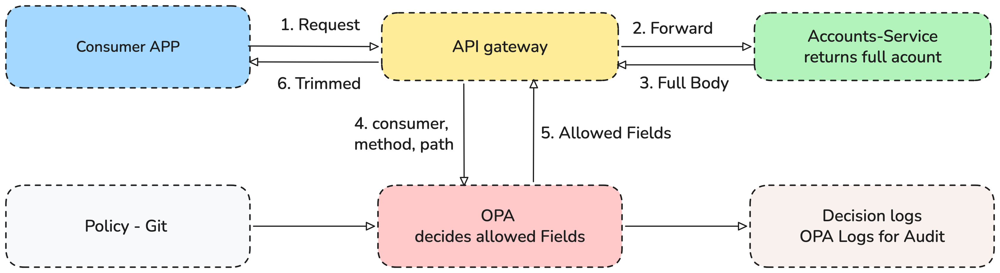
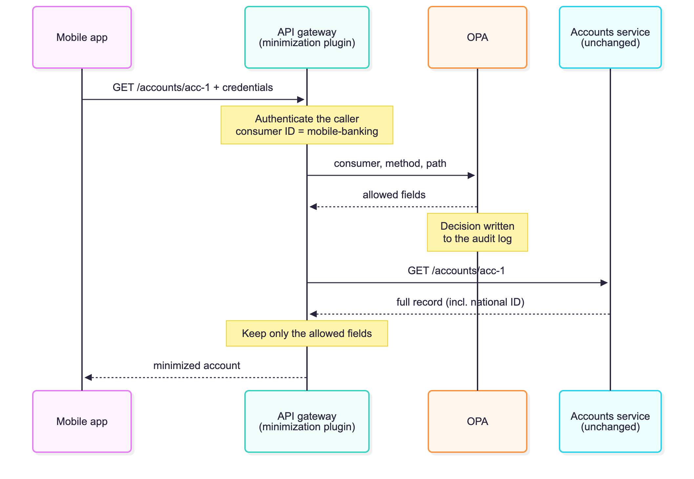
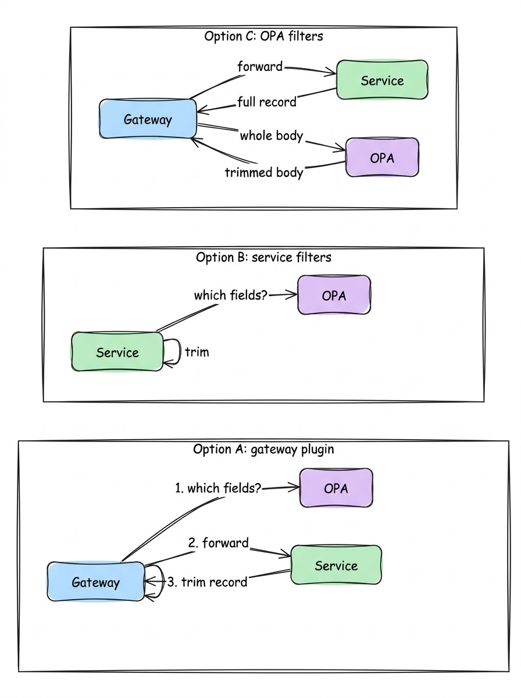
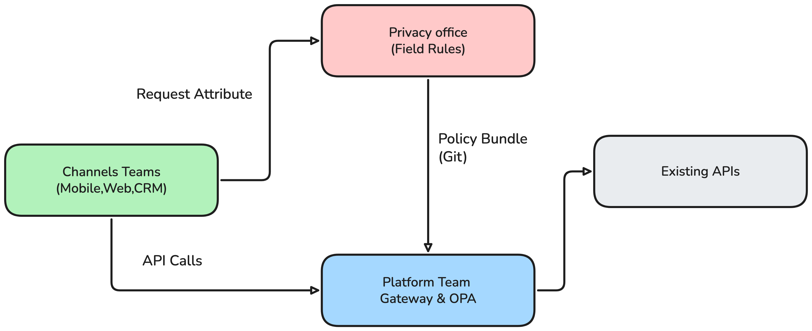

Data minimization should be a policy you can version, test and audit, not field filtering scattered through the code.

[Open Policy Agent (OPA)](https://www.openpolicyagent.org/) is a practical way to get there.

# Introduction

Customer profile and KYC data reside within the Core Banking system and are exposed via a single, general-purpose "Customer Details" API (This is another issue to discuss later).

This API serves all digital channels and internal consumers, including the mobile banking app, web portal, and back-office applications.

Over time, this "one size fits all" approach turns into a severe architecture liability and security concerns.

- **Version churn and payload bloat:**

  The mobile app only needs a preferred name and language to render the dashboard. The Loan management system needs detailed KYC and income details. Every time one client demands two extra attributes the shared api contract gets Heavy response or re-versioned. This leads to heavy payload size and slower response time.

- **Data Minimization & Compliance Violations:**

  The API returns a payload containing sensitive personal and KYC attributes. Most consuming applications only require a small subset of this data (e.g., basic contact details or display names). Exposing unneeded sensitive data to these channels violates basic data privacy principles and regulatory data minimization mandates.

Check [OWASP API Security Top 10 API3:2023 Broken Object Prop](https://api-security.owasp.org/editions/2023/en/0xa3-broken-object-property-level-authorization/)

# What data minimization means for APIs

I found a lot of definition on what data minimization means for APIs , here is what I select:

- Data minimization in an API means each endpoint accepts and returns only the data its purpose needs, by default.

- Data minimization for APIs is the practice of design system interfaces to collect and return only the minimum amount of personal or sensitive information required to complete a specific task.

To implement Data Minimization effectively we need to focus on these core areas:

1.  Collection limiting: Defining how and why the data is being collected.

2.  Processing: Ensuring that data is used in ways reasonably related to its original purpose, rather than being reused for secondary or unrelated tasks.

3.  Retention Control: Data should be kept only as long as is necessary this involves having tools and systems in place to erase state sensitive data.

Data minimization is now a common regulatory requirement, by adopting this proactive at scale, organizations can stay ahead of regulatory expectations.

# Open Policy Agent (OPA)

[Open Policy Agent (OPA)](++https://www.openpolicyagent.org/) is an open source general purpose policy engine that unifies policy enforcement across the stack.

- What is Policy?

  Policy defines allowed operations and controls system behaviors, such as Authorize user, implement API access controls. OPA is Policy as Code, that you can write rules and express as code.

OPA decouples policy decision-making from policy enforcement.

OPA Polices are expressed in a high level declarative language called Rego. Rego is purpose built for expressing policies over complex data structures. [policy-language](https://www.openpolicyagent.org/docs/policy-language)

# Usecase & Solution Architecture

Now we will see OPA in Action, where we will use OPA Policy to show data minimization on API.Most Organizations have dozens of existing APIs and user by partners and internal application, Rewriting those APIs isn’t realistic and neither is asking every team to change its code

So the question I want to answer here, can we add data minimization to APIs we already have without changing them and without changing how anyone calls them? I built a small proof of concept to find out.

## Use Case

Assume that we have an Account api that has been in production for years. It has two end points :

- 
- 

As these APIs are very old, it returns the full record to anyone allowed to call it.

The API is consumed by the following consumers:

- Mobile banking app: Customers check their balance, initiate payments and use spending insights (PFM) to see where their money goes.

- Web banking: The same journeys as mobile, plus downloading and printing statements.

- CRM (contact center): An agent helping a customer on the phone needs their contact details.

All three channels belong to the bank, but "internal" doesn’t mean "allowed to see everything". Each channel needs a different slice of the data, for a different reason. Here is what each one should actually receive from the account overview:

<table>
<colgroup>
<col style="width: 25%" />
<col style="width: 25%" />
<col style="width: 25%" />
<col style="width: 25%" />
</colgroup>
<tbody>
<tr>
<td style="text-align: left;">
Filed
</td>
<td style="text-align: left;">
Mobile App
</td>
<td style="text-align: left;">
Web App
</td>
<td style="text-align: left;">
CRM
</td>
</tr>
<tr>
<td style="text-align: left;">
Account id, nickname, currency
</td>
<td style="text-align: left;">
✓
</td>
<td style="text-align: left;">
✓
</td>
<td style="text-align: left;">
✓
</td>
</tr>
<tr>
<td style="text-align: left;">
Balance
</td>
<td style="text-align: left;">
✓
</td>
<td style="text-align: left;">
✓
</td>
<td style="text-align: left;">
✓
</td>
</tr>
<tr>
<td style="text-align: left;">
IBAN
</td>
<td style="text-align: left;">
✓
</td>
<td style="text-align: left;">
✓
</td>
<td style="text-align: left;">
✓
</td>
</tr>
<tr>
<td style="text-align: left;">
Customer Name
</td>
<td style="text-align: left;">
✓
</td>
<td style="text-align: left;">
✓
</td>
<td style="text-align: left;">
✓
</td>
</tr>
<tr>
<td style="text-align: left;">
Mobile, email , Address
</td>
<td style="text-align: left;">
x
</td>
<td style="text-align: left;">
x
</td>
<td style="text-align: left;">
✓
</td>
</tr>
<tr>
<td style="text-align: left;">
National ID, date of birth
</td>
<td style="text-align: left;">
x
</td>
<td style="text-align: left;">
x
</td>
<td style="text-align: left;">
x
</td>
</tr>
</tbody>
</table>

And for Transaction history API :

<table>
<colgroup>
<col style="width: 25%" />
<col style="width: 25%" />
<col style="width: 25%" />
<col style="width: 25%" />
</colgroup>
<tbody>
<tr>
<td style="text-align: left;">
Filed
</td>
<td style="text-align: left;">
Mobile App
</td>
<td style="text-align: left;">
Web App
</td>
<td style="text-align: left;">
CRM
</td>
</tr>
<tr>
<td style="text-align: left;">
Transaction id, date, amount, Description
</td>
<td style="text-align: left;">
✓
</td>
<td style="text-align: left;">
✓
</td>
<td style="text-align: left;">
✓
</td>
</tr>
<tr>
<td style="text-align: left;">
Transaction Category
</td>
<td style="text-align: left;">
✓
</td>
<td style="text-align: left;">
✓
</td>
<td style="text-align: left;">
x
</td>
</tr>
</tbody>
</table>

As you see in the last row in the Account API table no one gets the national ID and date of birth not even the bank staff using the CRM.

## Solution Architecture

Every call to these APIs already passes through the API gateway and the gateway already know which channel is calling because it authenticated the channel’s credential. This makes it the natural place to enforce minimization

The design splits the job in two: OPA makes the decision, and a plugin in the gateway enforces it. In access-control terms, OPA is the Policy Decision Point (PDP) and the gateway plugin is the Policy Enforcement Point (PEP).

<figure>

<figcaption>API minimization High level Architecture</figcaption>
</figure>

<figure>

<figcaption>API Minimization Sequence Diagram</figcaption>
</figure>

The flow for every request will be:

1.  The channel calls the API exactly as it does today (No change).

2.  The gateway authenticate the caller (No change).

3.  The plugin asks OPA which fields this channel may receive from this endpoint it sends three things :

    1.  Consumer ID

    2.  HTTP method

    3.  PATH

    If OPA can’t be reached, the request stops here with an error and the backend is never called.

4.  The Gateway forward the request to the Accounts Service which will return the full record. (No Change)

5.  The plugin removes every field that isn’t on OPA’s list and returns the trimmed response.

6.  OPA logs the decision: which channel, which endpoint, which fields it allowed and when. With policies shipped as bundles, the log also records the policy version that made the decision.

The plugin itself depends on your gateway: a custom plugin in Kong, a JavaScript or Java callout policy in Apigee. The logic is the same in all of them, and it’s simple: ask OPA, filter the JSON, return it.

Other places I considered The gateway isn’t the only place this could live, so it’s worth saying why I didn’t pick the others:

- Inside each service. It works, and the service has the most context. But every team has to change its code, and you end up with one implementation per team.

- A sidecar proxy next to each service. No code changes, but every team has to deploy and run an extra container. In practice that’s another change request per team.

- The service mesh. If you run Istio, the sidecar is already there, so this looks free. But changing response bodies in Istio means an EnvoyFilter (a low-level API that Istio itself warns can break on upgrades) or a WasmPlugin (a compiled module you have to build and maintain). That’s a lot of platform risk for one feature.

- A central "minimization service" in front of the APIs. It’s easy to build, but it adds a network hop to every call and becomes a new component everything depends on.

## OPA Policy & Rule

The rules are plain data, JSON formate that can be read by the team. Each channel has an entry: what it is , Who owns it, why it gets data and which fileds it may receive from which end point.

    "mobile-banking": {
      "description": "Retail mobile app",
      "owner": "Digital Channels",
      "purpose": "Customer self-service: balances, payments, spending insights (PFM)",
      "apis": {
        "GET /accounts/{id}": [
          "id", "nickname", "currency", "iban", "balance", "owner.name"
        ],
        "GET /accounts/{id}/transactions": [
          "accountId",
          "transactions.id", "transactions.date", "transactions.amount",
          "transactions.currency", "transactions.description",
          "transactions.category"
        ]
      }
    }

OPA Rego policy :

    package accounts.minimize

    import rego.v1

    allowed_fields contains field if {
        some api, fields in data.consumers[input.consumer_id].apis
        endpoint_matches(api, input.method, input.path)
        some field in fields
    }

The above policy look up the channel find the endpoint rule that match this request and return its fields. endpoint\_matches, compares the method and the path segment by segment.

To run OPA I used the following command on docker :

    docker run --name my-opa -it  -p 8181:8181 openpolicyagent/opa run --server --addr :8181

Now OPA is available at the url : <http://localhost:8181/>

To integrate with OPA I used [OPA REST Service](https://www.openpolicyagent.org/docs/integration):

- Create a new Policy :

      ###
      PUT http://localhost:8181/v1/policies/minimize
      Content-Type: text/plain

      package accounts.minimize

      import rego.v1

      allowed_fields contains field if {
              some api, fields in data.consumers[input.consumer_id].apis
              endpoint_matches(api, input.method, input.path)
              some field in fields
      }

      # "GET /accounts/{id}" matches GET /accounts/acc-1 but not /accounts/acc-1/x
      endpoint_matches(api, method, path) if {
              parts := split(api, " ")
              parts[0] == method
              template := split(parts[1], "/")
              actual := split(path, "/")
              count(template) == count(actual)
              every i, segment in template {
                      segment_matches(segment, actual[i])
              }
      }

      segment_matches(segment, _) if {
              startswith(segment, "{")
              endswith(segment, "}")
      }

      segment_matches(segment, value) if segment == value

      purpose := data.consumers[input.consumer_id].purpose
      array_field := "transactions"
      array_prefix := concat("", [array_field, "."])

      top_paths := [replace(f, ".", "/") |
              some f in allowed_fields
              f != array_field
              not startswith(f, array_prefix)
      ]

      # Paths applied to each element of the array.
      item_paths := [replace(trim_prefix(f, array_prefix), ".", "/") |
              some f in allowed_fields
              startswith(f, array_prefix)
      ]

      base := json.filter(object.remove(input.resource, [array_field]), top_paths)

      items := input.resource[array_field] if {
              array_field in allowed_fields
      } else := [json.filter(t, item_paths) | some t in input.resource[array_field]]

      any_item_access if array_field in allowed_fields

      any_item_access if count(item_paths) > 0

      filtered := object.union(base, {array_field: items}) if {
              input.resource[array_field]
              any_item_access
      } else := base

- Validate the Create Policy :

      curl --location 'http://localhost:8181/v1/policies/minimize'

- Now we will create the DATA, The data we pushed is called a base document in OPA. It is external information that our policy needs to make decisions, but it is not part of the policy logic itself and not part of the request (input).

  Think of it as a configuration/reference table that our policy looks up. In our case, it defines: Which consumer is allowed to see which fields from which API endpoint?

      # Option A: Push to /v1/data/consumers with just the inner object
      curl -X PUT http://localhost:8181/v1/data/consumers \
        -H "Content-Type: application/json" \
        -d '{
        "mobile-banking": {
          "description": "Retail mobile app",
          "owner": "Digital Channels",
          "purpose": "Customer self-service: balances, payments, spending insights (PFM)",
          "apis": {
            "GET /accounts/{id}": [
              "id",
              "nickname",
              "currency",
              "iban",
              "balance",
              "owner.name"
            ],
            "GET /accounts/{id}/transactions": [
              "accountId",
              "transactions.id",
              "transactions.date",
              "transactions.amount",
              "transactions.currency",
              "transactions.description",
              "transactions.category"
            ]
          }
        }
      }'

- Now we will test our policy from the OPA side to see what is the allowed fields for the mobile-banking channels from account service :

      POST http://localhost:8181/v1/data/accounts/minimize/allowed_fields
      Content-Type: application/json

      {
        "input": {
          "consumer_id": "mobile-banking",
          "method": "GET",
          "path": "/accounts/acc-1"
        }
      }

  Response:

      HTTP/1.1 200 OK
      Content-Type: application/json
      Vary: Accept-Encoding
      Date: Sun, 15 Nov 2026 20:41:03 GMT
      Content-Length: 70

      {
        "result": [
          "balance",
          "currency",
          "iban",
          "id",
          "nickname",
          "owner.name"
        ]
      }

  If we change the "consumer\_id": "mobile-banking" to "consumer\_id": "crm" the response will be:

      HTTP/1.1 200 OK
      Content-Type: application/json
      Vary: Accept-Encoding
      Date: Sun, 15 Nov 2026 20:43:27 GMT
      Content-Length: 134

      {
        "result": [
          "balance",
          "currency",
          "iban",
          "id",
          "nickname",
          "owner.address",
          "owner.dateOfBirth",
          "owner.email",
          "owner.name",
          "owner.phone"
        ]
      }

  As you see the allowed attribute list contains the :

  - "owner.address",

  - "owner.dateOfBirth",

  - "owner.email",

  - "owner.phone"

  While those attributes are missing for "consumer\_id": "mobile-banking"

OPA can also filter the Response for Example input from the mobile APP :

    POST http://localhost:8181/v1/data/accounts/minimize/filtered
    Content-Type: application/json

    {
      "input": {
        "consumer_id": "mobile-banking",
        "method": "GET",
        "path": "/accounts/acc-1/transactions",
        "resource": {
          "accountId": "acc-1",
          "transactions": [
            {
              "amount": -45.5,
              "category": "restaurants",
              "currency": "SAR",
              "date": "2026-11-01",
              "description": "Card payment - Cafe",
              "id": "t-1",
              "location": {
                "lat": 24.73,
                "lon": 46.65
              }
            },
            {
              "amount": -230,
              "category": "groceries",
              "currency": "SAR",
              "date": "2026-11-01",
              "description": "Card payment - Supermarket",
              "id": "t-2",
              "location": {
                "lat": 24.73,
                "lon": 46.65
              }
            }
          ]
        }
      }
    }

And this is OPA answer:

    {
      "result": {
        "accountId": "acc-1",
        "transactions": [
          {
            "amount": -45.5,
            "category": "restaurants",
            "currency": "SAR",
            "date": "2026-11-01",
            "description": "Card payment - Cafe",
            "id": "t-1"
          },
          {
            "amount": -230,
            "category": "groceries",
            "currency": "SAR",
            "date": "2026-11-01",
            "description": "Card payment - Supermarket",
            "id": "t-2"
          }
        ]
      }
    }

As you see the response is missing the **Location** attribute

Onboarding a new channel, or giving an existing one a new field, means adding a few lines to the JSON file and publishing a new policy bundle. No service is redeployed.

Note: Policies created through OPA’s REST API are not persisted to disk, so they are lost when the container restarts.

To make this persisted I will create policy directory and Start OPA container with the folder mounted:

    docker run --name my-opa -p 8181:8181 -v $PWD/policy:/policy openpolicyagent/opa \
        run --server --addr=0.0.0.0:8181 /policy

Every time the container starts, OPA loads the policy and data from those files, so nothing is lost on restart.However, with this option the policy will be created with different id than we create it with REST API

To simplify the POC I used Spring Cloud Gateway with minimization logic written as a custom gateway filter. That filter simulates the plugin that you’d build for kong or Apigee.

I have split the traffic into three paths using StripPrefix=1 on each so the downstream service receives the exact same request regardless of how it entered the gateway.

- The Baseline (/passthrough/\*\*):

  This route does nothing to the payload, it proxies the request straight to the backend account service and handle the response back.

  When hit, the service queries OPA directly for the allowed attribute list and trims the response before returning it to the gateway.

      - id: passthrough
        uri: ${BACKEND_URL:http://localhost:8080}
        predicates:
          - Path=/passthrough/**
        filters:
          - StripPrefix=1

- OPA Decides, Gateway Trims (/gateway/\*\*)

  This route split the responsibility using a custom OpaMinimizer filter, The gateway asks OPA for the allowed attribute list , OPA evaluate the policy and returns the allowed attribute list and the Gateway filter handles the body filter and trim the JSON payload.

      - id: option-a-gateway-plugin
        uri: ${BACKEND_URL:http://localhost:8080}
        predicates:
          - Path=/gateway/**
        filters:
          - StripPrefix=1
          - OpaMinimize

      return opa.allowedFields(consumer, method, path)
          .map(Optional::of)
          .onErrorResume(e -> {
              log.warn("OPA unavailable: {}", e.toString());
              return Mono.just(Optional.<List<String>>empty());
          })
          .flatMap(decision -> decision.isEmpty()
              ? Exchanges.reject(exchange, HttpStatus.SERVICE_UNAVAILABLE, "policy decision unavailable")
              : trimResponse(decision.get()).filter(exchange, chain));

- OPA Does Everything (/opa/\*\*)

  This route use a custom filter OpaTilterBody, where the entire filtering step is handled by OPA.The gateway receive the response from account service and send it over to OPA, OPA evaluate the policy and remove the unauthorized fields and sends the trimmed payload back to the gateway to be returned back to the consumer.

      - id: option-c-opa-filters
        uri: ${BACKEND_URL:http://localhost:8080}
        predicates:
          - Path=/opa/**
        filters:
          - StripPrefix=1
          - OpaFilterBody

      return opa.filter(consumer, method, path, body)
          .onErrorResume(e -> { // Fail closed: no decision, no data.
               log.warn("OPA unavailable: {}", e.toString());
               response.setStatusCode(HttpStatus.SERVICE_UNAVAILABLE);
              return Mono.just(Exchanges.errorBody("policy decision unavailable"));
          });

With this three routes and policy in place I was able to compare three places to do the filtering all using the same policy and same rules:

- Option A: The gateway plugin.

  The gateway filter asks OPA for the list of allowed fields and removes the rest.

- Option B: The service filters.

  The service asks OPA for the list itself and trims the object before returning it.

- Option C: OPA filters.

  The gateway sends the whole response body to OPA, and OPA returns it already trimmed.

<figure>

<figcaption aria-hidden="true">where the filtering happens in each option</figcaption>
</figure>

# Enterprise Architecture View

From Enterprise Architecture point of view data minimization shouldn’t be a feature of one API. It’s a shared capability like authentication or logging. if every team builds its own version, there is no guarantee what the mobile app actually receives.

This is the next level after the identity and access management, IAM decides whether a channel may call an API, Data minimization decides what channel gets back.

The design splits the work between three groups:

1.  The data privacy office owns the rules:which channel sees which fields and why.

2.  The Platform team runs the gateway and OPA.

3.  Channel team requests the fields they need, with a reason,The API team change nothing.

<figure>

<figcaption aria-hidden="true">who owns what</figcaption>
</figure>

Developers usually decides what an API returns, and the easy choice is always return everything, this design moves that decision to the team who is accountable for it.
